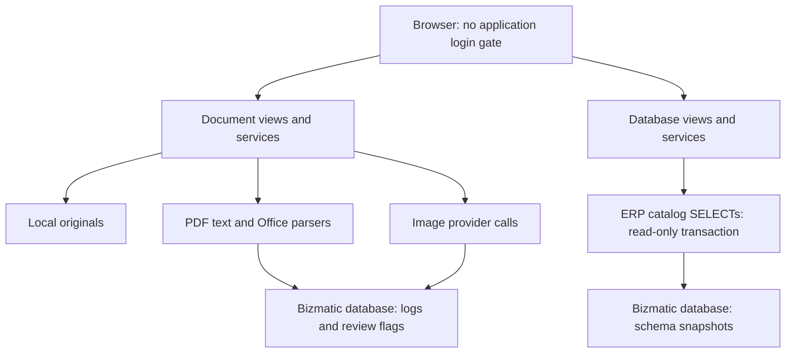
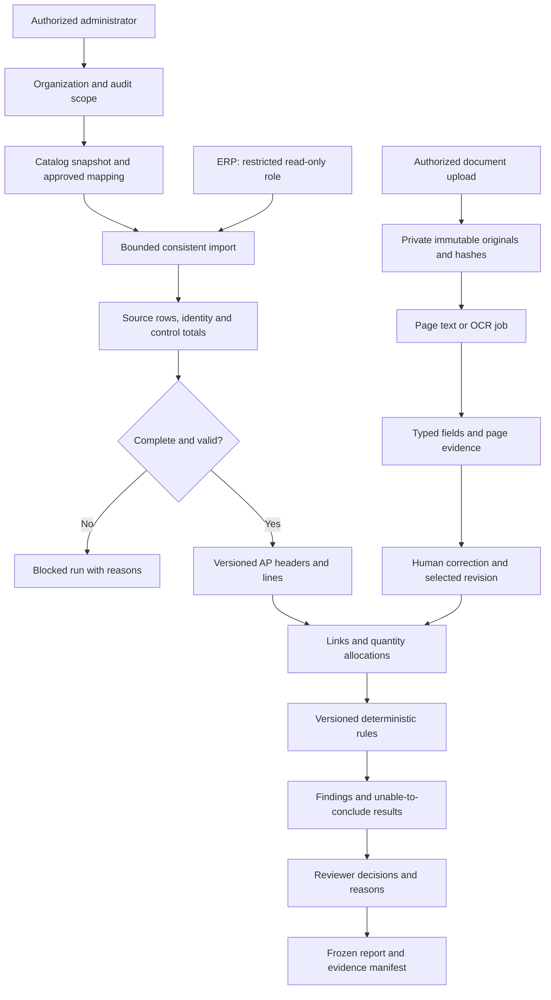
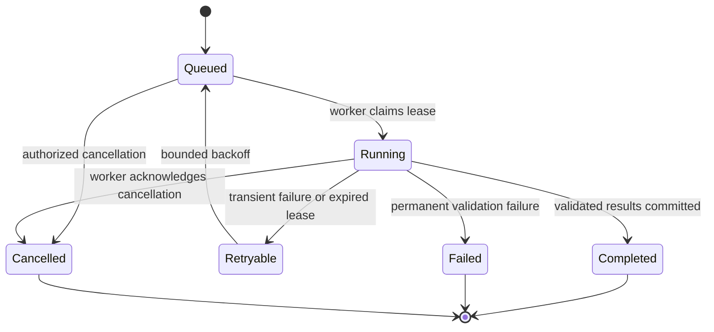

# Data flow and trust boundaries

## Current implementation

Source: [bizmatic_django/document_extraction/views.py:24](https://github.com/dindog18/bizmatic/blob/f8c1bec08a22ac27cd77b7349f85368983fc1092/bizmatic_django/document_extraction/views.py#L24), [bizmatic_django/document_extraction/util.py:22](https://github.com/dindog18/bizmatic/blob/f8c1bec08a22ac27cd77b7349f85368983fc1092/bizmatic_django/document_extraction/util.py#L22), [bizmatic_django/db_extraction/services/postgres.py:81](https://github.com/dindog18/bizmatic/blob/f8c1bec08a22ac27cd77b7349f85368983fc1092/bizmatic_django/db_extraction/services/postgres.py#L81). There is currently **no path from source transaction rows to document evidence**, and no reconciliation/report node. PDF uploads take the text-parser branch even if their pages are scanned. Browser review actions write to Bizmatic only.

## Proposed AP audit flow

All mutations after the ERP node target Bizmatic's own database or private evidence storage. **No arrow returns to the ERP.** The web app must not possess a source write role. The report includes import failures, unreviewed/ambiguous matches and missing evidence so omissions cannot produce a misleading clean result.

## Boundaries and payloads

| Boundary | Allowed payload | Required control |
| --- | --- | --- |
| Browser → Bizmatic | Uploads, mapping selections, review decisions | Authentication, role and organization scope, CSRF, quotas, optimistic version checks |
| Worker → ERP | Catalog queries and explicit allowlisted SELECT projections | Approved destination, TLS identity, read-only role/transaction, query/runtime budgets, no Django migrations on source |
| ERP → Bizmatic | Allowed source fields plus complete keys and scope | Versioned mapping, consistent import, raw-value provenance, rejection and control counts |
| Bizmatic → OCR provider | Approved document/page bytes and extraction prompt | Organization/provider approval before dispatch, HTTPS or explicitly approved local endpoint, bounded bytes/pages/cost, sanitized errors |
| Worker → local persistence | Job results, attempts, canonical records and evidence | Idempotent writes; short transactions; committed-result recovery; no hidden partial publish |
| Bizmatic → reviewer/report | Only authorized organization evidence and results | Private downloads, page/field citations, report manifest and immutable decisions |

## Job and audit lifecycle

A job attempt is immutable once terminal. Retry creates an attempt while preserving identity and idempotency. A document may need human review even after its extraction job completes. An audit run must reference completed import and selected extraction revisions; unresolved evidence creates an explicit incomplete finding/coverage state. Report issuance freezes that state. Reprocessing generates a new run linked to the prior run and does not erase prior decisions.
